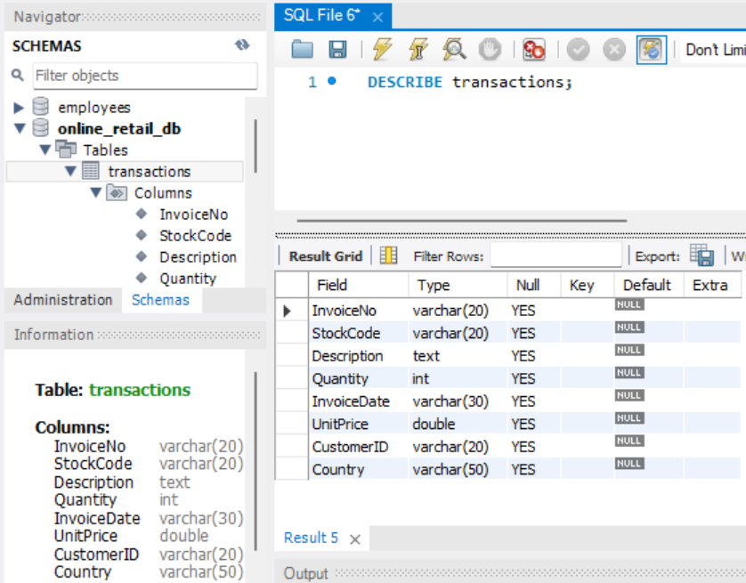
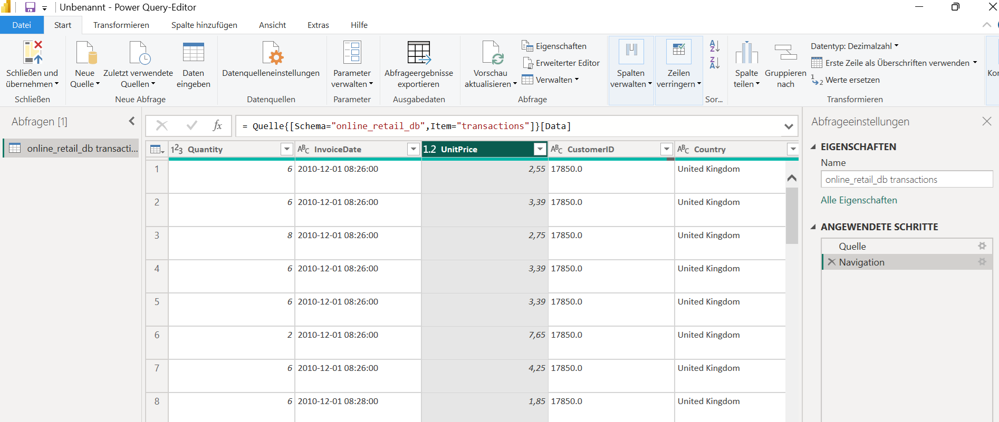
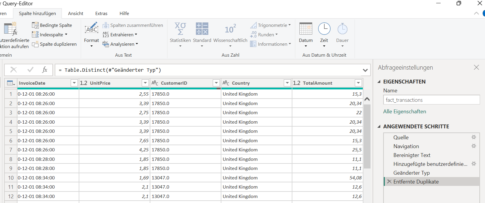

# 🌍 Global Sales Performance Analytics (UK vs. Rest of World)

> **End-to-End Data Analytics Case Study: Analyse von Online-Retail-Transaktionen mit Fokus auf ein sauberes Datenmodell, präzise DAX-Metriken und ein kognitiv entlastendes UI/UX-Design.**

---

## 🚀 Executive Summary

Das Ziel dieses Projekts war eine fundierte End-to-End-Analyse von Online-Retail-Transaktionen, aufgeteilt in den Heimatmarkt (UK) und den internationalen Markt (Rest of World). Von der explorativen Datenanalyse in MySQL über die ETL-Strecke in Power Query und komplexe DAX-Modellierung bis hin zum minimalistischen UI/UX-Redesign liefert diese Case Study datengetriebene Handlungsempfehlungen für die strategische Markt- und Logistikplanung.

---

## 🛠️ Tech Stack & Methodik

- **Datenbank & SQL:** MySQL (Exploration, Data Profiling, Aggregationen)[cite: 17, 18, 19]
- **ETL & Modellierung:** Power Query (Datenbereinigung, Typisierung, Calculated Columns)[cite: 21, 22, 23, 24]
- **Business Intelligence:** Power BI, DAX (KPI-Entwicklung)[cite: 25, 26]
- **Design System:** Minimalist UI/UX (Petrol-Accent, Custom Cards, Grid Layout)[cite: 26]

---

## 🔍 Phase 1: Data Exploration & Profiling (SQL)

Bevor Daten in das Dashboard flossen, fand die initiale Exploration und Datenprofilierung in MySQL statt. Ziel war es, die Tabellenstruktur zu verstehen, Anomalien (wie Retouren oder fehlende Kunden-IDs) zu identifizieren und erste Top-Aggregationen zu berechnen.

1. **Rohdaten-Struktur:** Überprüfung der Tabellenstruktur via `DESCRIBE transactions;` in MySQL, um Datentypen für den Import vorzubereiten[cite: 17].

[cite: 17]

2. **Data Profiling & Anomalien:** Identifikation von Retouren (negative Mengen) und fehlenden Kunden-IDs im Datensatz[cite: 18].

[cite: 18]

3. **Top-Kunden Aggregation:** Fortgeschrittene SQL-Abfrage (`GROUP BY`, Aggregationen, `LIMIT 5`), um erste Einblicke in die umsatzstärksten Kunden zu erhalten[cite: 19].

[cite: 19]

---

## ⚙️ Phase 2: ETL & Data Modeling

Im zweiten Schritt wurden die bereinigten Daten aus der MySQL-Datenbank via direktem Connector in Power BI importiert. Über den Power Query-Editor erfolgte die Transformation und Typisierung.

1. **Datenbank-Verbindung:** Anbindung der lokalen MySQL-Datenbank an Power BI[cite: 20].

[cite: 20]

2. **Daten-Import & Transformation:** Auswahl der `transactions`-Tabelle im Navigator und korrekte Typisierung im Power Query-Editor[cite: 21, 22].

[cite: 21]
[cite: 22]

3. **Berechnete Spalten & Bereinigung:** Erstellung einer benutzerdefinierten Spalte (`TotalAmount` = Menge $\times$ Einzelpreis) und saubere Dublettenbereinigung für die Faktentabelle `fact_transactions`[cite: 23, 24].

[cite: 23]
[cite: 24]

---

## 📐 Phase 3: DAX Calculations & Business Logic

Um die Rohdaten in aussagekräftige Business-Metriken zu übersetzen, wurden essenzielle KPIs (wie Total Revenue, Average Order Value und Revenue per Customer) via DAX direkt im Datenmodell definiert[cite: 25].

[cite: 25]

---

## 🎨 Phase 4: UX/UI Dashboard Architecture & Final Product

Im finalen Schritt folgte das UI/UX-Redesign: Weg von unruhigen Gitternetzlinien, hin zu einem minimalistischen "Floating-Card"-Layout mit einem konsistenten Farb- und Typografiekonzept zur Reduzierung kognitiver Last[cite: 26].

* **Implementierung:** Petrol-Design (`#005B60`), optimierte KPI-Karten, saubere Markt-Segmentierung (UK vs. Rest of World) und klare visuelle Hierarchien[cite: 26].

[cite: 26]

---

## 💡 Phase 5: Business Insights & Strategic Recommendations

1. **Starke Markt-Konzentration (UK-Abhängigkeit):** 
   - Über 80 % des Gesamtumsatzes entfallen auf das United Kingdom.
   - *Empfehlung:* Diversifikation und gezielte Marketing-Skalierung in den verbleibenden Kernmärkten zur Risikominimierung.
2. **Hohes Potenzial durch Key Accounts (Beispiel Niederlande):** 
   - Der umsatzstärkste Einzelkunde sitzt in den Niederlanden ($280k Umsatz bei 74 Bestellungen)[cite: 19].
   - *Empfehlung:* Identifikation ähnlicher B2B-/Großkunden-Profile im europäischen Ausland.
3. **Saisonale Peaks im Q4:** 
   - Die Zeitreihe zeigt einen massiven Umsatzanstieg ab September/Oktober mit einem Peak im November (Weihnachtsgeschäft)[cite: 26].
   - *Empfehlung:* Frühzeitige Lager- und Logistikplanung ab Q3 zur Vermeidung von Bottlenecks.
4. **Markt-Exklusivität beim Top-Produkt (`DOTCOM POSTAGE`):** 
   - Das umsatzstärkste Produkt wird fast ausschließlich im UK-Markt vertrieben[cite: 26].
   - *Empfehlung:* Prüfung der internationalen Nachfrage und Rollout-Potenziale für den Markt “Rest of World”.

---

## 📂 Repository-Struktur

```text
├── 📁 data/                       # Rohdaten & SQL Dumps (transactions.sql)
├── 📁 power_bi/                   # Power BI Berichtsdatei (.pbix)
├── 📜 queries.sql                 # SQL-Skripte für Profiling & Aggregationen[cite: 17, 18, 19]
├── 🖼️ sql-table-structure-profiling.png      # SQL Tabellenstruktur[cite: 17]
├── 🖼️ sql-data-profiling-metrics.png         # SQL Data Profiling Metriken[cite: 18]
├── 🖼️ sql-top-customers-aggregation.png      # SQL Top-Kunden Abfrage[cite: 19]
├── 🖼️ power-bi-mysql-connector-setup.png     # Power BI DB Connector[cite: 20]
├── 🖼️ power-bi-navigator-import.png          # Power BI Navigator[cite: 21]
├── 🖼️ power-query-initial-view.png           # Power Query Editor[cite: 22]
├── 🖼️ power-query-calculated-column.png      # TotalAmount Berechnung[cite: 23]
├── 🖼️ power-query-applied-steps-duplicates.png # Dublettenbereinigung[cite: 24]
├── 🖼️ power-bi-dax-measures-overview.png     # DAX Measures Übersicht[cite: 25]
└── 🖼️ power-bi-petrol-dashboard-ui.png       # Finales Petrol Dashboard UI[cite: 26]
