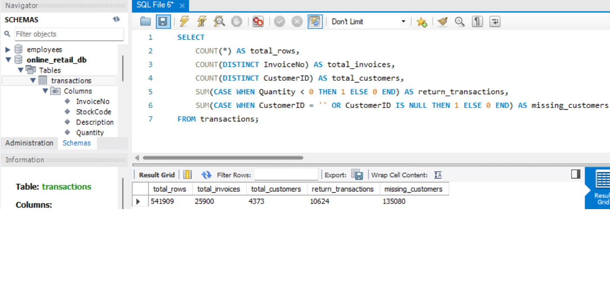
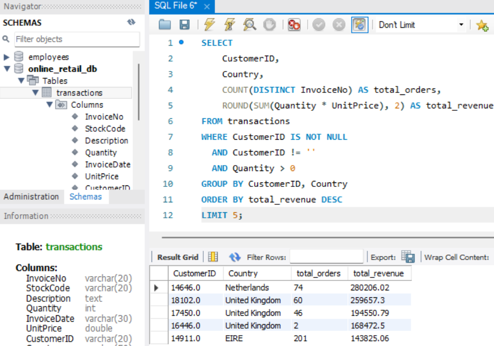
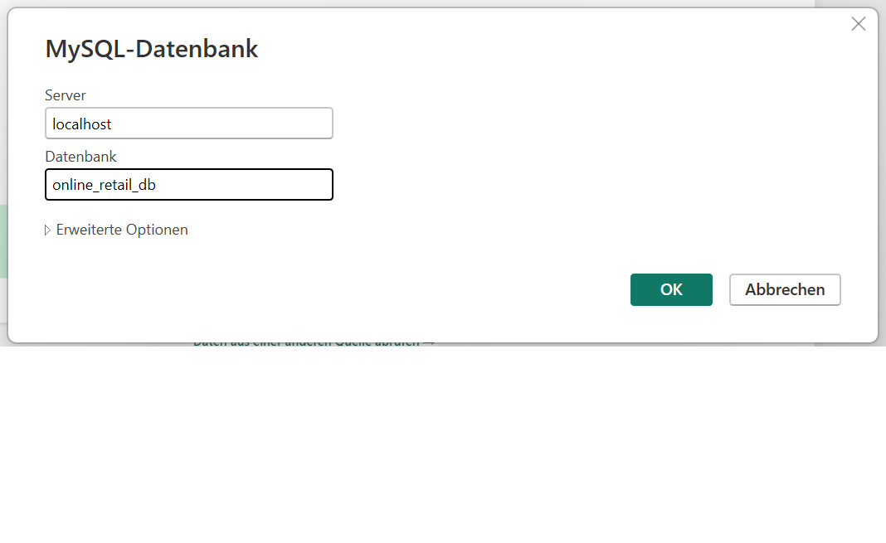
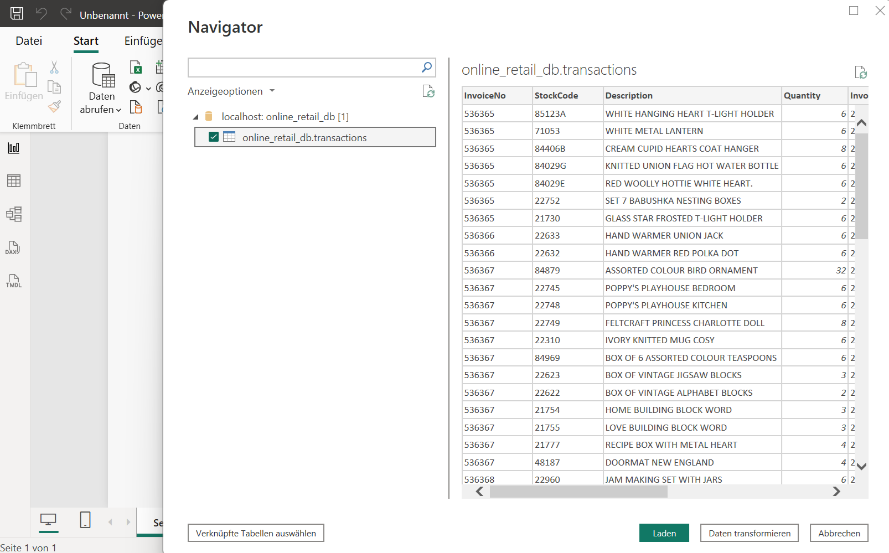
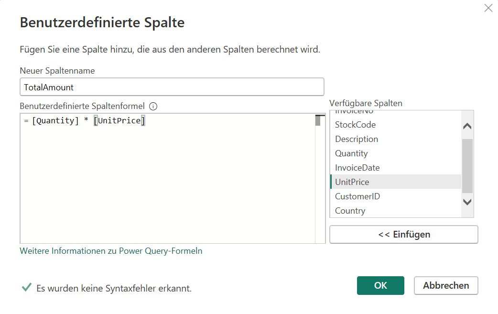
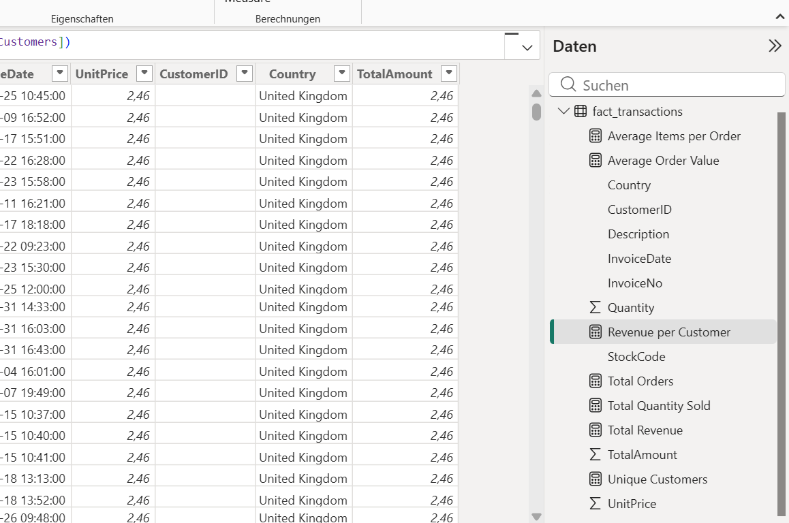
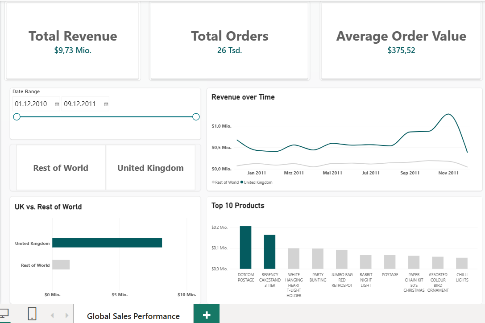

# 🌍 Global Sales Performance Analytics (UK vs. Rest of World)

End-to-End Data Analytics Case Study: Analyse von Online-Retail-Transaktionen mit Fokus auf ein sauberes Datenmodell, präzise DAX-Metriken und ein kognitiv entlastendes UI/UX-Design.

---

## 🚀 Executive Summary

Das Ziel dieses Projekts war eine fundierte End-to-End-Analyse von Online-Retail-Transaktionen, aufgeteilt in den Heimatmarkt (UK) und den internationalen Markt (Rest of World). Von der explorativen Datenanalyse in MySQL über die ETL-Strecke in Power Query und komplexe DAX-Modellierung bis hin zum minimalistischen UI/UX-Design liefert diese Case Study datengetriebene Handlungsempfehlungen für die strategische Markt- und Logistikplanung.

*Hinweis zum Datensatz:* Für diese Case Study wurden strukturierte, anonymisierte Test- und Beispieldaten (Dummy-Data) im branchenüblichen Retail-Format verwendet, um die ETL-Strecke, das Datenmodell und das Dashboard datenschutzkonform zu demonstrieren.

---

## 🛠️ Tech Stack & Methodik

* **Datenbank & SQL:** MySQL (Exploration, Data Profiling, Aggregationen)
* **ETL & Modellierung:** Power Query (Datenbereinigung, Typisierung, Calculated Columns)
* **Business Intelligence:** Power BI, DAX (KPI-Entwicklung)
* **Design System:** Minimalist UI/UX (Petrol-Accent, Custom Cards, Grid Layout)

---

## 🔍 Phase 1: Data Exploration & Profiling (SQL)

Bevor Daten in das Dashboard flossen, fand die initiale Exploration und Datenprofiling in MySQL statt. Ziel war es, die Tabellenstruktur zu verstehen, Anomalien (wie Retouren oder fehlende Kunden-IDs) zu identifizieren und erste Top-Aggregationen zu berechnen.

1. **Rohdaten-Struktur:** Überprüfung der Tabellenstruktur via `DESCRIBE transactions;` in MySQL, um Datentypen für den Import vorzubereiten.
   
   

2. **Data Profiling & Anomalien:** Identifikation von Retouren (negative Mengen) und fehlenden Kunden-IDs im Datensatz.
   
   

3. **Top-Kunden Aggregation:** Fortgeschrittene SQL-Abfrage (`GROUP BY`, Aggregationen, `LIMIT 5`), um erste Einblicke in die umsatzstärksten Kunden zu erhalten.
   
   

---

## ⚙️ Phase 2: ETL & Data Modeling

Im zweiten Schritt wurden die bereinigten Daten aus der MySQL-Datenbank via direktem Connector in Power BI importiert. Über den Power Query-Editor erfolgte die Transformation und Typisierung.

1. **Datenbank-Verbindung:** Anbindung der lokalen MySQL-Datenbank an Power BI.
   
   

2. **Daten-Import & Transformation:** Auswahl der `transactions`-Tabelle im Navigator und korrekte Typisierung im Power Query-Editor.
   
   
   
   

3. **Berechnete Spalten & Bereinigung:** Erstellung einer benutzerdefinierten Spalte (`TotalAmount = Menge * Einzelpreis`) und saubere Dublettenbereinigung für die Faktentabelle (`fact_transactions`).
   
   
   
   

---

## 📐 Phase 3: DAX Calculations & Business Logic

Um die Rohdaten in aussagekräftige Business-Metriken zu übersetzen, wurden essenzielle KPIs (wie Total Revenue, Average Order Value und Revenue per Customer) via DAX direkt im Datenmodell definiert.



---

## 🎨 Phase 4: UX/UI Dashboard Architecture & Final Product

Im finalen Schritt folgte das UI/UX-Redesign: Weg von unruhigen Gitternetzlinien, hin zu einem minimalistischen „Floating-Card“-Layout mit einem konsistenten Farb- und Typografiekonzept zur Reduzierung kognitiver Last.

* **Implementierung:** Petrol-Design (Akzente), optimierte KPI-Karten, saubere Markt-Segmentierung (UK vs. Rest of World) und klare visuelle Hierarchien.



---

## 💡 Phase 5: Business Insights & Strategic Recommendations

1. **Starke Markt-Konzentration (UK-Abhängigkeit):**
   * Über 80 % des Gesamtumsatzes entfallen auf das United Kingdom.
   * *Empfehlung:* Diversifikation und gezielte Marketing-Skalierung in den verbleibenden Kernmärkten zur Risikominimierung.
2. **Hohes Potenzial durch Key Accounts (Beispiel Niederlande):**
   * Der umsatzstärkste Einzelkunde sitzt in den Niederlanden ($280k Umsatz bei 74 Bestellungen).
   * *Empfehlung:* Identifikation ähnlicher B2B-/Großkunden-Profile im europäischen Ausland.
3. **Saisonale Peaks im Q4:**
   * Die Zeitreihe zeigt einen massiven Umsatzanstieg ab September/Oktober mit einem Peak im November (Weihnachtsgeschäft).
   * *Empfehlung:* Frühzeitige Lager- und Logistikplanung ab Q3 zur Vermeidung von Bottlenecks.
4. **Markt-Exklusivität beim Top-Produkt (DOTCOM POSTAGE):**
   * Das umsatzstärkste Produkt wird fast ausschließlich im UK-Markt vertrieben.
   * *Empfehlung:* Prüfung der internationalen Nachfrage und Rollout-Potenziale für den Markt „Rest of World“.

---

## 📂 Repository-Struktur

```text
├── Power_bi/
│   └── global_sales_performance.pbix # Finales Power BI Dashboard
├── Pictures/
│   ├── sql-table-structure-profiling.png
│   ├── sql-data-profiling-metrics.png
│   ├── sql-top-customers-aggregation.png
│   ├── power-bi-mysql-connector-setup.png
│   ├── power-bi-navigator-import.png
│   ├── power-query-initial-view.png
│   ├── power-query-calculated-column.png
│   ├── power-query-applied-steps-duplicates.png
│   ├── power-bi-dax-measures-overview.png
│   └── power-bi-petrol-dashboard-ui.png
└── README.md                      # Projektdokumentation
